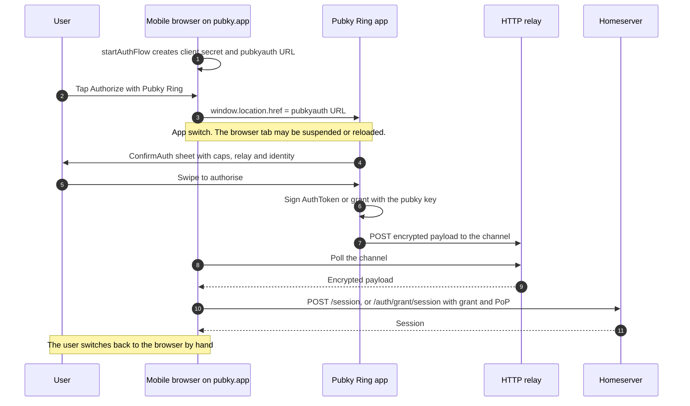
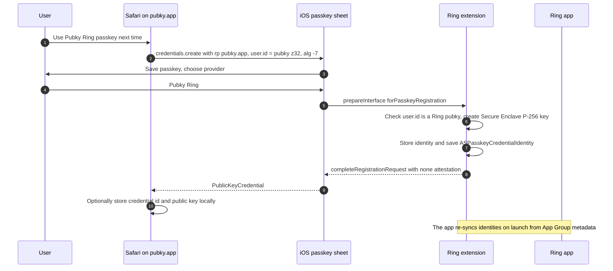
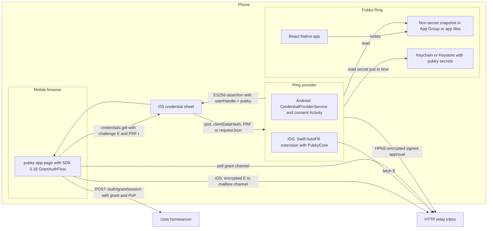
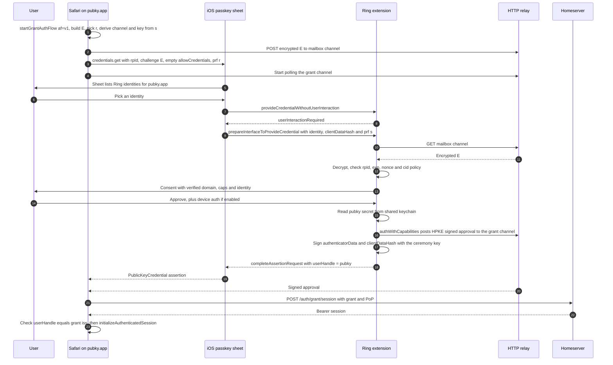
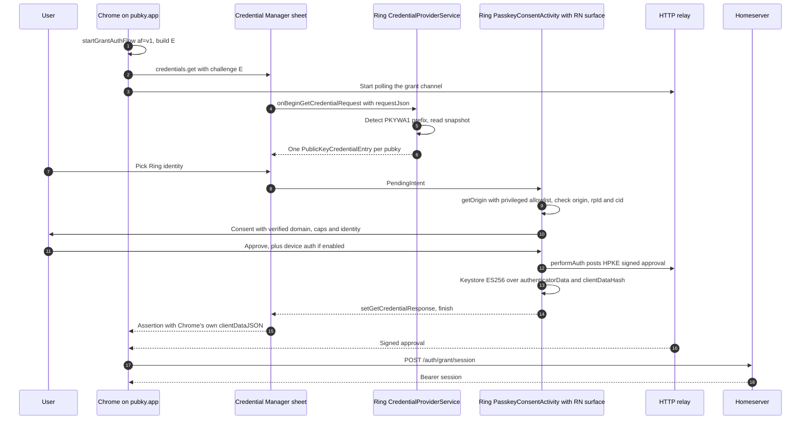
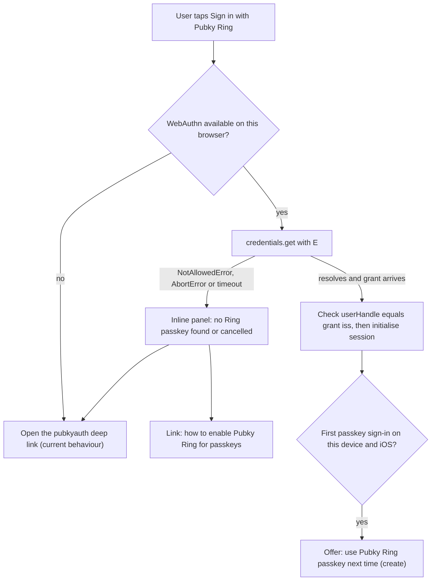

# Pubky Ring as an OS passkey provider: design and implementation plan

Status: proposal, nothing implemented yet. Scope: mobile only (iOS and Android). Desktop keeps the existing QR code and HTTP relay exchange, and no browser extensions are planned.

Written against:

- Ring `main` at `b1f9157` (this repository).
- [catch-21/pubky-app](https://github.com/catch-21/pubky-app), default branch `dev` at [`c933021`](https://github.com/catch-21/pubky-app/tree/c933021cb3bc0c0ea6b2046fb802b6a0877c4809).
- [pubky/pubky-homeserver](https://github.com/pubky/pubky-homeserver) (formerly `pubky-core`) at [`a616858`](https://github.com/pubky/pubky-homeserver/tree/a6168589a3c8c4874d838c13a0fa2ea31417dfd0).
- [pubky/agent-skills](https://github.com/pubky/agent-skills) at `038f17cf` (`pubky` and `pubky-mobile` skills, including `references/ring-auth.md`).
- [pubky.org/llms-full.txt](https://pubky.org/llms-full.txt), and Apple, Android, Chromium and WebKit documentation and source as linked inline.

Every claim carries one of these tags:

| Tag | Meaning |
|---|---|
| **[Verified]** | Read in source code or official documentation (linked). |
| **[Reported]** | Third-party or community evidence only. Treat as likely, not certain. |
| **[Unverified]** | Inference or an open question. It must be confirmed before anything depends on it. |
| **[Spike]** | Unverified, and milestone (a) is designed to answer it. |

## Contents

1. [Summary and recommendations](#1-summary-and-recommendations)
2. [How sign-in works today](#2-how-sign-in-works-today)
3. [Platform facts that constrain the design](#3-platform-facts-that-constrain-the-design)
4. [Mapping pubkyauth onto a WebAuthn request](#4-mapping-pubkyauth-onto-a-webauthn-request)
5. [iOS: AutoFill credential provider extension](#5-ios-autofill-credential-provider-extension)
6. [Android: Credential Manager provider](#6-android-credential-manager-provider)
7. [Capability consent UI and code reuse](#7-capability-consent-ui-and-code-reuse)
8. [Security analysis](#8-security-analysis)
9. [Fallback and user setup](#9-fallback-and-user-setup)
10. [pubky-app demo changes](#10-pubky-app-demo-changes)
11. [Ring change list](#11-ring-change-list)
12. [Milestones](#12-milestones)
13. [Blockers and risks](#13-blockers-and-risks)
14. [Decisions needed from James](#14-decisions-needed-from-james)
15. [References](#15-references)

## 1. Summary and recommendations

**Neither OS blocks the idea, but iOS makes it harder than a textbook passkey integration.** A third-party provider can answer WebAuthn requests from mobile browsers for any rpId on both platforms. The hard constraint is on iOS: the provider never sees the WebAuthn challenge, only its hash, so the challenge cannot carry the Pubky request there **[Verified]**. iOS also effectively supports only ES256 for provider passkeys **[Verified for Apple's API surface, Reported for runtime behaviour]**, so Ring's Ed25519 pubky key cannot be the passkey key.

Recommendations:

1. **Use WebAuthn as a verified-origin invocation channel, and keep the Pubky grant as the credential (Design A, section 4.2).** The web app starts a normal Pubky grant flow (`signin_grant` with signed approvals, `af=v1`). It hands the flow's `pubkyauth://` URL to Ring inside a WebAuthn `get()` request. Ring shows its consent UI inside the OS sheet, signs the grant with the pubky key, and posts it to the HTTP relay exactly as it does today. It then completes the WebAuthn ceremony with an ES256 assertion from a per-site "ceremony key". The app receives the session through the SDK's existing `awaitApproval`/`tryPollOnce` and creates it with the homeserver's existing `POST /auth/grant/session`. **The homeserver and the SDK need no changes.**
2. **A standard passkey assertion is not enough on its own, and Pubky does not need a new server-side verifier for the MVP.** The homeserver only understands grants with proof-of-possession (PoP) proofs, plus legacy AuthTokens. The assertion's job is to complete the OS ceremony and carry `userHandle` = the user's pubky. The web app checks that the pubky matches the grant's issuer, which defeats a racing forged approval (section 8.3). A true passkey design, where the homeserver verifies WebAuthn assertions as PoP proofs, is a possible upstream follow-up (Design C), not part of this plan.
3. **The request reaches Ring differently on each platform.**
   - **Android:** in the challenge. The provider receives the full request JSON **[Verified]**.
   - **iOS:** through an encrypted "request mailbox" on the HTTP relay. The lookup key comes from the WebAuthn PRF extension input, which the provider receives on iOS 18 and later **[Reported, Spike]**.
   - **iOS alternative:** if the spike shows iOS routes requests with unknown `allowCredentials` IDs to the provider's own list UI, the request can travel in `allowCredentials` instead **[Spike]**.
4. **Always use signed approvals (`af=v1`, HPKE to `epk`).** The request then contains no secrets, which matters because on Android every enabled provider sees it. The legacy cookie flow, which puts a bearer-equivalent `secret` in the URL, must never travel through WebAuthn.
5. **iOS extension: native Swift and SwiftUI, with no React Native.** Link the existing uniffi `PubkyCore` bindings, read Ring's keys from the existing keychain access group, and read the non-secret state from an App Group snapshot.
6. **Android provider:** a Kotlin `CredentialProviderService`, plus a consent `Activity` that hosts a React Native surface reusing Ring's existing consent logic, keychain access and `performAuth`. Android 14 (API 34) or later is required for third-party providers **[Verified]**.
7. **The OS-verified rpId is the main security gain over today's relay model.** Ring requires the request's `cid` to match the rpId the OS reports, and shows that domain as verified. Approvals can then only be delivered to keys held by a page on that origin.
8. **The pubky-app demo needs an SDK upgrade first.** The fork pins `@synonymdev/pubky` 0.8.0, which has no grant flow **[Verified]**. 0.18.0 is current.
9. **Build the spike first.** It decides the iOS request channel and could rule out the iOS path; Android is low risk.

## 2. How sign-in works today

### 2.1 The pubkyauth grant flow

Current Pubky apps use **grant authentication**.

1. The app starts a flow with capabilities (`caps`), a client ID (`cid`), a relay and a client PoP key (`cpk`).
2. The flow produces a `pubkyauth://signin_grant?...` URL, rendered as a QR code or opened as a deep link.
3. The authenticator (Ring) shows consent. It signs a `pubky-grant` JWS with the user's Ed25519 key, with claims `iss`, `client_id`, `caps`, `cnf` (= `cpk`), `jti`, `iat` and `exp`.
4. Ring encrypts the result and POSTs it to the relay.
5. The app decrypts it and exchanges the grant and a `pubky-pop` proof at `POST /auth/grant/session` for a bearer token **[Verified]**. Sources: [`auth.md`](https://github.com/pubky/agent-skills) lines 37–49; [`grant.rs`](https://github.com/pubky/pubky-homeserver/blob/a6168589a3c8c4874d838c13a0fa2ea31417dfd0/pubky-common/src/auth/grant.rs) lines 34–48; [`grant_exchange.rs`](https://github.com/pubky/pubky-homeserver/blob/a6168589a3c8c4874d838c13a0fa2ea31417dfd0/pubky-sdk/src/actors/auth/grant/grant_exchange.rs) lines 88–103.

Key details:

- **URL parameters** **[Verified]** ([`ring-auth.md`](https://github.com/pubky/agent-skills) lines 390–437; [`query_params.rs`](https://github.com/pubky/pubky-homeserver/blob/a6168589a3c8c4874d838c13a0fa2ea31417dfd0/pubky-sdk/src/actors/auth/deep_links/query_params.rs)):
  - Required: `caps`, `relay`, `cid`, `cpk` (z-base-32).
  - Plus either a bare-grant `secret` (32 bytes, base64url) or `af=v1` with `epk` (a 32-byte X25519 HPKE public key).
  - Optional: `spk`, the expected signer.
- **Relay channel** **[Verified]**:
  - Bare grant: `base64url(blake3(secret))`.
  - Signed approval: `base64url(blake3("pubky-grant-relay-channel-v1\0" || epk))` ([`grant_relay_channel.rs`](https://github.com/pubky/pubky-homeserver/blob/a6168589a3c8c4874d838c13a0fa2ea31417dfd0/pubky-sdk/src/actors/auth/deep_links/grant_relay_channel.rs) lines 6–33).
  - The inbox relay stores a message for about 5 minutes. Request bodies are capped at 2 KiB by default ([`auth.md`](https://github.com/pubky/agent-skills) lines 437–452).
- **Encryption** **[Verified]**: XSalsa20-Poly1305 with `secret` for bare grants, or HPKE (X25519, HKDF-SHA256, ChaCha20-Poly1305) to `epk` for signed approvals ([`crypto.rs`](https://github.com/pubky/pubky-homeserver/blob/a6168589a3c8c4874d838c13a0fa2ea31417dfd0/pubky-common/src/crypto.rs) lines 33–64; [`approval_encryption.rs`](https://github.com/pubky/pubky-homeserver/blob/a6168589a3c8c4874d838c13a0fa2ea31417dfd0/pubky-sdk/src/actors/auth/grant/approval_encryption.rs) lines 3–15).
- **Replay protection** **[Verified]**:
  - Each PoP proof carries `aud` (the homeserver key) and a nonce, and `iat` must be within ±180 s of server time.
  - Nonces are tracked in the homeserver database ([`pop_verifier.rs`](https://github.com/pubky/pubky-homeserver/blob/a6168589a3c8c4874d838c13a0fa2ea31417dfd0/pubky-homeserver/src/client_server/auth/grant/crypto/pop_verifier.rs) lines 22–106).
  - Grants expire after 2 years by default ([`constants.rs`](https://github.com/pubky/pubky-homeserver/blob/a6168589a3c8c4874d838c13a0fa2ea31417dfd0/pubky-sdk/src/actors/auth/grant/constants.rs) line 2).
- **Legacy cookie flow** **[Verified]**: `pubkyauth:///?caps&relay&secret`, or `signin`. Ring signs a postcard-serialised `AuthToken` (signature, `"PUBKY:AUTH"`, version, timestamp in microseconds, pubky, capabilities), which is 134 bytes for `/pub/pubky.app/:rw`. The homeserver accepts it at `POST /session` within ±180 s ([`auth_token.rs`](https://github.com/pubky/pubky-homeserver/blob/a6168589a3c8c4874d838c13a0fa2ea31417dfd0/pubky-common/src/auth/auth_token.rs) lines 12–184; [`cookie/verifier.rs`](https://github.com/pubky/pubky-homeserver/blob/a6168589a3c8c4874d838c13a0fa2ea31417dfd0/pubky-homeserver/src/client_server/auth/cookie/verifier.rs)). Anyone who holds `secret` can decrypt the token and redeem it first, so the token is effectively a bearer credential.

### 2.2 Ring today

- **Deep links:** `pubkyauth` and `pubkyring` URL schemes. See `ios/pubkyring/Info.plist` (`CFBundleURLSchemes`) and the `MainActivity` intent filter in `android/app/src/main/AndroidManifest.xml`.
- **Parsing:** native `parseDeepLink`. Relay transport is checked by `hasAuthRelayTransport` (`src/utils/inputParser.ts` lines 259–267), which accepts `secret`, or `af=v1` with `epk`.
- **Dispatch:** `handleAuthAction` (`src/utils/actions/authAction.ts` lines 84–132) either auto-authorises or opens the `ConfirmAuth` sheet.
- **Consent screen** (`src/screens/ConfirmAuth.tsx`) shows:
  - the requesting client (`client_id`, or `x-source`);
  - the capabilities, with read, write and encrypt icons;
  - a toggle for encryption keys;
  - the relay host;
  - an expected-identity banner (`spk`);
  - a 60 s timeout (`CONFIRM_AUTH_TIMEOUT_MS`, line 79).
- **Signing:** `performAuth` (`src/utils/pubky.ts` lines 1185–1311).
  1. Optional device authentication (`requireDeviceAuthentication`, `src/utils/deviceAuth.ts` line 112).
  2. Reads the secret key.
  3. Signs up to the homeserver if needed.
  4. Calls native `auth(url, secretKey)` or `authWithCapabilities(url, secretKey, approved)`.
  5. On failure, signs in to the homeserver and retries once.
  6. Everything runs under a 20 s deadline.
- **Key storage:**
  - Secret keys are stored with `react-native-keychain` under service and account `<pubky>`, as JSON `{secretKey, mnemonic}` (`src/utils/pubky.ts` line 579; `src/utils/keychain.ts` line 35).
  - On iOS no access group is passed, so items go to the first entry in `keychain-access-groups`, which is `$(AppIdentifierPrefix)app.pubkyring` (`ios/pubkyring/pubkyring.entitlements`). The library defaults to `AccessibleAfterFirstUnlock`. **[Verified in source; Apple's default-group rule, Verified in Apple docs]**
  - A second access group, `pubky.shared`, already shares keys with Bitkit (`ios/pubkyring/SharedPubky.m` lines 4–5). This proves the team already manages cross-binary keychain sharing.
- **App state:** Redux persisted to MMKV in the app sandbox (`src/store/mmkv-storage.ts` line 4), so an iOS extension cannot read it today.
- **Native core:** `@synonymdev/react-native-pubky` 0.15.0 ships uniffi bindings over a Rust `libpubkycore`.
  - Swift: `ios/pubkycore.swift`, about 65 MB static `.a` per architecture.
  - Kotlin: `uniffi/pubkycore/pubkycore.kt`, with `.so` files per ABI.
  - They expose `auth(url:secretKey:)`, `authWithCapabilities`, `parseDeepLink` and `parseAuthUrl` as plain functions. Swift and Kotlin code can call them without React Native. **[Verified by unpacking the npm tarball]**
- **Platform floors:** iOS deployment target 15.1 (`project.pbxproj`). Android `minSdkVersion` 24, `compileSdkVersion` 37 (`android/build.gradle`). Android `applicationId` `to.pubky.ring`, iOS bundle ID `app.pubkyring`, Apple team `KYH47R284B`.

### 2.3 pubky-app today

The mobile button is labelled **"Authorize with Pubky Ring"**. It is hard-coded English with no i18n key, and appears in two places:

- [`SignIn.tsx`](https://github.com/catch-21/pubky-app/blob/c933021cb3bc0c0ea6b2046fb802b6a0877c4809/src/components/organisms/SignIn/SignIn.tsx#L117-L134) (lines 117–134, mobile container `md:hidden` at line 184);
- [`Scan.tsx`](https://github.com/catch-21/pubky-app/blob/c933021cb3bc0c0ea6b2046fb802b6a0877c4809/src/components/organisms/Scan/Scan.tsx#L47-L63) (signup, lines 47–63 and 96).

Desktop (`hidden md:flex`) renders the same URL as a QR code. Mobile and desktop are told apart only by CSS breakpoints, with no user-agent detection.

When tapped:

1. [`useMobileAuth.onAuthorizeClick`](https://github.com/catch-21/pubky-app/blob/c933021cb3bc0c0ea6b2046fb802b6a0877c4809/src/hooks/useMobileAuth/useMobileAuth.tsx#L46-L69) sets `window.location.href = url`.
2. The URL comes from [`HomeserverService.generateAuthUrl`](https://github.com/catch-21/pubky-app/blob/c933021cb3bc0c0ea6b2046fb802b6a0877c4809/src/core/services/homeserver/homeserver.ts#L309-L321), which calls `pubkySdk.startAuthFlow('/pub/pubky.app/:rw', AuthFlowKind.signin(), getDefaultHttpRelay())`. That is the **legacy cookie flow** of SDK 0.8.0, with `secret` in the URL.
3. The relay comes from `PUBKY_RUNTIME_DEFAULT_HTTP_RELAY`. The dev and preview default is `https://httprelay.staging.pubky.app/inbox`.
4. Approval is awaited by polling `tryPollOnce` every 100 ms for up to 5 minutes ([`homeserver.utils.ts`](https://github.com/catch-21/pubky-app/blob/c933021cb3bc0c0ea6b2046fb802b6a0877c4809/src/core/services/homeserver/homeserver.utils.ts#L31-L33)).
5. The session is then handed to `AuthController.initializeAuthenticatedSession`.

No `xCallback` is passed, so after approving in Ring the user has to switch back to the browser by hand. Signup rewrites the sign-in URL host to `signup` and adds `hs` and `st` (lines 337–356, marked as a temporary hack).

Other facts about the fork:

- There is no `public/.well-known`, no CSP or `Permissions-Policy` header, and no WebAuthn code.
- The app has Next.js App Router API routes under `src/app/api/`, but none relate to auth.
- Tests use Vitest (unit and visual regression) and Cypress (E2E). Packages are managed with npm.



## 3. Platform facts that constrain the design

| Topic | iOS (AuthenticationServices) | Android (Credential Manager) |
|---|---|---|
| Minimum OS for third-party passkey providers | iOS 17.0 (`prepareCredentialList(for:requestParameters:)`, `ASPasskeyCredentialRequest`) **[Verified]** | Android 14, API 34 (`CredentialProviderService` is `@RequiresApi(34)`) **[Verified]** |
| What the provider sees | rpId, `clientDataHash`, `allowedCredentials` (list UI path only), user-verification preference, extension inputs (iOS 18+: `prf`, `largeBlob`). **No challenge, no origin, no `clientDataJSON`.** **[Verified]** | Full request JSON (`BeginGetPublicKeyCredentialOption.requestJson`), including challenge, `allowCredentials` and extensions. Origin through `CallingAppInfo.getOrigin(privilegedAllowlist)` for allowlisted browsers, plus the browser's `clientDataHash` **[Verified]** |
| What the provider signs | `authenticatorData` followed by `clientDataHash` (WebAuthn §6.3.3). The system supplies `clientDataJSON` **[Verified]** | Same. For browser calls, sign the provided `clientDataHash` and return a placeholder `clientDataJSON`, which Chrome replaces with its own **[Verified]** |
| Algorithms | `ASCOSEAlgorithmIdentifier` defines only `ES256`. WebKit's modern path does not forward `pubKeyCredParams` to platform passkey requests. Open-source providers ship ES256 only **[Verified API surface; runtime acceptance of -8, Unverified]** | Chrome forwards `pubKeyCredParams` and accepts EdDSA (-8) responses with a `publicKey` field **[Verified in Chromium source]** |
| When the provider appears | Passkeys show in the sheet from entries the provider added to `ASCredentialIdentityStore` (`ASPasskeyCredentialIdentity`). Whether iOS offers the provider's own list UI when no identity matches is **[Spike]** | The system calls every enabled provider's `onBeginGetCredentialRequest`, which returns entries dynamically. No pre-registration needed **[Verified]** |
| rpId association | Browsers enforce rpId against the page origin. Associated domains (`webcredentials`) are needed only when a native app calls `ASAuthorization` **[Verified]** | Digital Asset Links are needed only for native app callers. Browsers are trusted through the privileged allowlist **[Verified]** |
| Enabling the provider | Settings > General > AutoFill & Passwords (iOS 18 and 26). Settings > Passwords > Password Options (iOS 17). `ASSettingsHelper.requestToTurnOnCredentialProviderExtension` (iOS 18+) **[Verified]** | Settings > Passwords, passkeys & accounts (wording varies by OEM). `CredentialManager.createSettingsPendingIntent()` (API 34+) **[Verified]** |
| Process model | Separate extension process with a tight memory limit (community figure about 120 MB, some report about 80 MB) **[Reported]** | Service and activity run in Ring's own process and app UID **[Verified]** |
| Browser coverage | Safari, plus Chrome and Firefox on iOS, which all use WebKit **[Verified]** | Chrome on Android 14+ **[Verified]**. Firefox 128+ has open reliability bugs **[Reported]**. Samsung Internet is on Google's allowlist, but support is **[Unverified]** |

Primary sources:

- Apple:
  - [ASCredentialProviderViewController](https://developer.apple.com/documentation/authenticationservices/ascredentialproviderviewcontroller)
  - [ASPasskeyCredentialRequest](https://developer.apple.com/documentation/authenticationservices/aspasskeycredentialrequest)
  - [ASPasskeyCredentialRequestParameters](https://developer.apple.com/documentation/authenticationservices/aspasskeycredentialrequestparameters)
  - [ASCOSEAlgorithmIdentifier](https://developer.apple.com/documentation/authenticationservices/ascosealgorithmidentifier)
  - [ASPasskeyCredentialExtensionInput](https://developer.apple.com/documentation/authenticationservices/aspasskeycredentialextensioninput)
  - [ASCredentialIdentityStore](https://developer.apple.com/documentation/authenticationservices/ascredentialidentitystore)
  - [ASSettingsHelper](https://developer.apple.com/documentation/authenticationservices/assettingshelper)
  - [Info.plist capabilities](https://developer.apple.com/documentation/bundleresources/information-property-list/nsextension/nsextensionattributes/ascredentialproviderextensioncapabilities)
  - [AutoFill credential provider entitlement](https://developer.apple.com/documentation/bundleresources/entitlements/com.apple.developer.authentication-services.autofill-credential-provider)
- Android:
  - [Integrate Credential Manager with your credential provider solution](https://developer.android.com/identity/sign-in/credential-provider)
  - [CredentialProviderService](https://developer.android.com/reference/androidx/credentials/provider/CredentialProviderService)
  - [CallingAppInfo](https://developer.android.com/reference/androidx/credentials/provider/CallingAppInfo)
  - [Google's privileged browser allowlist](https://www.gstatic.com/gpm-passkeys-privileged-apps/apps.json)
  - [Chrome: passkeys on Credential Manager](https://developer.chrome.com/blog/passkeys-on-credential-manager)
- Spec: [WebAuthn Level 3](https://www.w3.org/TR/webauthn-3/)
- WebKit `Source/WebKit/UIProcess/WebAuthentication/Cocoa/WebAuthenticatorCoordinatorProxy.mm`; Chromium `components/webauthn/json/value_conversions.cc` (see section 15).

## 4. Mapping pubkyauth onto a WebAuthn request

### 4.1 Requirements

1. Ring must receive the full grant request (`caps`, `cid`, `relay`, `cpk`, `epk`, optional `spk`) **before** it shows consent, because the user approves those capabilities.
2. The app must receive a grant that the homeserver accepts, without homeserver changes for the MVP.
3. Nothing a bystander sees (other providers, the relay, logs) may let an attacker obtain a session.
4. The user must stay in the browser.

### 4.2 Options considered

| Option | Summary | Verdict |
|---|---|---|
| **A. WebAuthn as invocation channel, grant over the relay** | The request travels with the WebAuthn call. Ring signs the normal grant, POSTs it to the relay and returns an ES256 assertion to finish the OS ceremony. The app collects the grant with the existing SDK polling. | **Recommended.** No homeserver or SDK protocol changes. Reuses Ring's signing code and the app's session code. |
| B. Grant returned inside the assertion | Smuggle the encrypted grant through assertion fields. `userHandle` (64 bytes maximum) is too small. `signature`, `largeBlob` read output or two 32-byte PRF results are opaque to browsers, but using them this way is non-standard. | Rejected for the MVP. It is fragile: any browser or OS validation of those fields breaks it, and `largeBlob` provider support on Android is **[Unverified]**. It would remove the relay round-trip, so it is worth revisiting only if relay latency matters. |
| C. Passkey as PoP key, homeserver verifies WebAuthn | At enrolment, Ring issues a grant whose `cnf` is the passkey's P-256 public key. Each sign-in is a WebAuthn assertion that the homeserver verifies (origin, rpIdHash, challenge bound to the session request) at a new endpoint. | Future and upstream only. It is the "real passkey" model (no relay, consent at enrolment), but needs P-256 `cnf`, a WebAuthn verifier in the homeserver and SDK support. Out of scope for the fork. |
| D. Legacy cookie flow with `secret` in the request | Keep pubky-app on SDK 0.8.0 and put the cookie-flow URL in the request. | **Rejected.** On Android every enabled provider sees the request JSON. With `secret`, any of them could decrypt the AuthToken and redeem it at `POST /session` within 180 s, which is a session hijack. |

### 4.3 WebAuthn field mapping (Design A)

| WebAuthn field | Value | Why |
|---|---|---|
| `rpId` | The page's host, for example `pubky.app` or the demo host. It must be the page origin or a registrable suffix of it. | The browser verifies it against the origin, so Ring treats it as the trusted requester identity. Hosts under public suffixes (for example `*.vercel.app` or `*.github.io`) must use the full host. |
| `challenge` | The **request envelope** `E` (section 4.4), about 250–400 bytes. | Android providers read it directly from the request JSON. On iOS it is hidden from the provider but committed in `clientDataHash`. A long challenge is allowed by the spec (the floor is 16 bytes, there is no maximum). Browser maximums are **[Spike]**. Fallback: `challenge = SHA-256(E)`, with `E` in `allowCredentials` on Android. |
| `allowCredentials` | Empty (discoverable credentials). | iOS shows Ring's identities for the rpId, one per pubky. Android needs nothing. The `allowCredentials` alternative for iOS is in section 4.5. |
| `userVerification` | `"preferred"` | Ring runs its own consent step and optional device authentication. It sets the UV flag only when device authentication ran. |
| `hints` | `["client-device"]` | Steers away from the hybrid and QR "use another device" options on mobile. |
| `timeout` | 120 000 ms | Covers consent (Ring's 60 s limit) and the network round-trips. |
| `extensions.prf.eval.first` | A random 32-byte `r` (the mailbox key seed, section 4.5) | The only per-request secret the page can pass to an iOS provider on the identity-selection path. |
| `userHandle` (response) | UTF-8 of the pubky in z-base-32 (52 bytes, within the 64-byte limit) | Lets the page bind the OS-selected identity to the grant's `iss`. |
| Credential ID (response) | Ring's ceremony credential ID for that pubky and rpId | Standard. Lets a page that enrolled via `create()` verify the signature if it wants to. |
| Assertion signature | ES256, made with a per-(install, rpId, pubky) **ceremony key** in the Secure Enclave (iOS) or Android Keystore. **Never the pubky key.** | iOS is ES256-only. Keeping the pubky key out of WebAuthn also gives domain separation from Pubky's JWS and AuthToken signing. |

### 4.4 Request envelope `E`

`E` is the SDK's own `authorizationUrl`, wrapped so Ring can recognise it, check its age and parse it with the existing `parseDeepLink`. Hand-building `pubkyauth://` URLs is discouraged upstream, so Ring never builds them ([`auth.md`](https://github.com/pubky/agent-skills) line 33).

```text
E = magic   "PKYWA1"          6 bytes, ASCII
    version 0x01              1 byte
    flags   u8                bit 0 = signup (reserved; v1 is sign-in only)
    exp     u32 big-endian    unix seconds; Ring rejects if now > exp or exp - now > 300
    nonce   16 bytes          random; Ring caches seen nonces until exp
    urlLen  u16 big-endian
    url     UTF-8             pubkyauth://signin_grant?caps=...&relay=...&cid=...&cpk=...&af=v1&epk=...[&spk=...]
```

Ring rejects `E` unless all of the following hold:

1. `parseDeepLink(url)` yields `signin_grant` with `af=v1`, `epk` present and no `secret`.
2. `relay` is `https:`.
3. `cid` satisfies the rpId policy (section 8.2).
4. `exp` is within bounds and `nonce` has not been seen before.

These checks deliberately reject bare grants and legacy links on this channel (option D).

### 4.5 Getting `E` to the provider

**Android:** read `E` from `requestJson.challenge` (base64url) in `onBeginGetCredentialRequest`. If the magic prefix is absent, return no entries, so Ring stays out of non-Pubky passkey requests.

**iOS, recommended: PRF-keyed request mailbox.** On the identity-selection path, the provider gets `credentialIdentity`, `clientDataHash` and `extensionInput` only. Of these, only the PRF input is page-chosen and per-request.

1. The page picks a random 32-byte value `r`.
2. Per WebAuthn L3 §10.1.4, the client hashes it to `s = SHA-256("WebAuthn PRF" || 0x00 || r)` before the authenticator sees it.
3. Both sides derive the mailbox from `s`:

   ```text
   k       = HKDF-SHA256(ikm = s, salt = "", info = "pubky-ring-webauthn-mailbox-v1/key", L = 32)
   channel = base64url(SHA-256("pubky-ring-webauthn-mailbox-v1/channel" || s))
   body    = nonce(12) || AES-256-GCM(k, nonce, E, aad = UTF-8(rpId))
   ```

4. The page POSTs `body` to `{mailboxRelay}/{channel}` **before** calling `get()`.
5. Ring GETs it, decrypts it, and checks that the AAD rpId equals `requestParameters.relyingPartyIdentifier` (or the identity's rpId).

Properties:

- The relay learns nothing: it sees only `channel`, from which `s` cannot be recovered.
- The relay cannot tamper, because the payload is authenticated encryption.
- Nobody can inject a request, because `s` is unguessable.
- Ring returns a standards-conformant PRF result, `HMAC-SHA256(ceremonyPrfKey, s)`, which the page ignores.

Open questions:

- Whether the provider receives the hashed `s` or the raw `r` is **[Spike]**. Apple's provider-side type is the same `ASAuthorizationPublicKeyCredentialPRFAssertionInput.InputValues` that relying-party apps use. Until the spike settles it, the page posts to both candidate channels, which costs one extra 2 KiB-capped POST.
- Third-party providers receiving PRF inputs on iOS 18 is supported by 1Password returning PRF results on iOS 18 ([Corbado PRF compatibility table](https://www.corbado.com/blog/passkeys-prf-webauthn), section 5.3.4) **[Reported]**.
- `mailboxRelay` is either Ring's default relay or discovered from `https://{rpId}/.well-known/pubky-auth.json`. That is decision 6 in section 14. For the demo, both resolve to the same relay as the grant flow.

**iOS alternative, if the spike allows: `allowCredentials` envelope.** Put `E` (or a 16-byte handle) as the single `allowCredentials[0].id`; credential IDs can be up to 1023 bytes. On the provider list path, `prepareCredentialList(for:requestParameters:)` receives `requestParameters.allowedCredentials` **[Verified]**. Whether iOS lists Ring and invokes that path when no stored identity matches the ID is **[Spike]**. If it does, this route works on iOS 17 too, needs no PRF, no mailbox and no enrolment, and replaces the mailbox.

Rejected for iOS:

- **`largeBlob` write data:** needs exactly one known `allowCredentials` entry, so the page must already know Ring's credential ID.
- **Predicting `clientDataHash`:** clients are allowed to add keys to `clientDataJSON` (Chrome injects one at random), so the hash cannot be predicted.
- **`create()`-carried data in `user.id`:** limited to 64 bytes, and shows "create passkey" UI on every sign-in.

### 4.6 iOS identity population (enrolment)

On iOS, Ring must have an `ASPasskeyCredentialIdentity` for the rpId before the sheet shows it. Two complementary routes:

1. **Page-initiated enrolment with `navigator.credentials.create()`.** After any successful sign-in, including through the deep-link fallback, pubky-app offers "Use Pubky Ring passkey next time on this device". It calls `create()` with:
   - `rp.id` = host;
   - `user.id` = UTF-8 z32 pubky, `user.name` = profile name;
   - `pubKeyCredParams: [{alg: -7}]`;
   - `residentKey: "required"`.

   Ring's `prepareInterface(forPasskeyRegistration:)` then:
   - checks that `user.id` is one of its pubkys;
   - creates the ceremony key;
   - stores the identity;
   - returns a `none`-attestation ES256 credential.

   This is a textbook passkey registration, and it works on Android too, where it is optional.
2. **Ring-side registration for known Pubky apps.** Ring adds identities for an allowlist of rpIds, and optionally for rpIds the user has already approved through the passkey path. Ring owns its identity store, so this needs no relying-party call **[Verified API; App Review acceptability, Unverified]**.



### 4.7 Is the assertion enough? Does Pubky need a verifier?

- **Homeserver:** no verifier is needed for the MVP. The homeserver never sees the assertion. It verifies the grant JWS (EdDSA by the pubky) and the PoP proof exactly as today ([`router.rs`](https://github.com/pubky/pubky-homeserver/blob/a6168589a3c8c4874d838c13a0fa2ea31417dfd0/pubky-homeserver/src/client_server/auth/router.rs) lines 28–35).
- **App:** a WebAuthn assertion cannot create a homeserver session on its own. The app uses it for two client-side checks, so no server verifier is needed:
  1. `userHandle` (the pubky) must equal the issuer of the grant that arrives through the relay (`session.info.publicKey.z32()`). This rejects any approval Ring did not produce for the identity the user picked in the OS sheet (section 8.3).
  2. Optional: if the page enrolled the ceremony credential (section 4.6), it verifies the ES256 signature over `authenticatorData || SHA-256(clientDataJSON)` with the stored public key. That proves the same Ring install answered, but adds little beyond the first check.
- **Can a third-party provider return a Pubky-signed payload?** Technically yes, through opaque fields. Two PRF results, for example, are 64 bytes, the size of an Ed25519 signature. But the page would have to rebuild the exact JWS signing input, and browser pass-through of those fields is not guaranteed. This is option B, rejected for the MVP.
- **Ed25519 (COSE -8):** possible on Android with Chrome and not available on iOS. The design uses ES256 ceremony keys on both platforms, so it does not depend on -8.

### 4.8 Architecture



## 5. iOS: AutoFill credential provider extension

### 5.1 Target and configuration

- **Target:** a new native Swift app extension, `PubkyRingCredentialProvider`, in `ios/pubkyring.xcodeproj`. This is a bare React Native project, so the target is added in Xcode or with a scripted `xcodeproj` edit, not with Expo config plugins.
  - Bundle ID: `$(RING_PASSKEY_EXTENSION_ID)` from `ios/Config/Signing.xcconfig` (decision 11).
  - Extension point: `com.apple.authentication-services-credential-provider-ui`.
  - Principal class: `CredentialProviderViewController`.
- **Deployment target:** iOS 17.0 for the extension. The PRF mailbox code is gated with `#available(iOS 18.0, *)` (decision 1). The app stays at 15.1, and Ring hides the passkey settings entry on older systems.
- **Info.plist `NSExtensionAttributes > ASCredentialProviderExtensionCapabilities`:**
  - `ProvidesPasskeys = YES`
  - `ProvidesPasswords = NO`
  - `ShowsConfigurationUI = YES`
  - `SupportsConditionalPasskeyRegistration = NO`

  **[Verified]**, [docs](https://developer.apple.com/documentation/bundleresources/information-property-list/nsextension/nsextensionattributes/ascredentialproviderextensioncapabilities).
- **Entitlements, on both the app and the extension:**
  - `com.apple.developer.authentication-services.autofill-credential-provider = YES` **[Verified]**;
  - `keychain-access-groups` containing `$(AppIdentifierPrefix)app.pubkyring`, so the extension can read Ring's existing items **[Verified rule; Spike to confirm with Ring's real items]**;
  - `com.apple.security.application-groups = $(RING_APP_GROUP)` for the snapshot and the identity metadata.
- **Signing:** upstream hard-wires team `KYH47R284B`, and `SharedPubky.m` hard-coded `KYH47R284B.pubky.shared`. The MVP moves the team, bundle IDs and App Group into `ios/Config/Signing.xcconfig`, and `SharedPubky.m` builds the group from `Info.plist` (decision 11).
- **Linking `PubkyCore`:**
  - The npm package ships a static `libpubkycore.a`, about 65 MB unstripped per architecture. Linking it into both the app and the extension duplicates it in the IPA.
  - Option 1, MVP: link it statically into the extension too, and accept the size. Measure the stripped size.
  - Option 2: build a dynamic `PubkyCore.framework` embedded once in the app's `Frameworks` directory and linked by both. That requires a change upstream in `react-native-pubky` or a local build.
  - The Swift bindings (`pubkycore.swift`) compile into the extension target unchanged.

### 5.2 Callback mapping

| Callback | Behaviour |
|---|---|
| `provideCredentialWithoutUserInteraction(for:)` | Always cancel with `ASExtensionError.userInteractionRequired`, because consent is mandatory. The system then calls the next method **[Verified]**. |
| `prepareInterfaceToProvideCredential(for: ASPasskeyCredentialRequest)` | The main path. The identity the user tapped gives the pubky and rpId. Read the PRF input from `extensionInput`, fetch and decrypt `E` from the mailbox, validate it, show consent, sign, POST to the relay, then build the assertion and call `completeAssertionRequest(using:)`. |
| `prepareCredentialList(for:requestParameters:)` | The list path, used when the user opens Ring's own list. Show a pubky picker. If `allowedCredentials` contains an envelope (the section 4.5 alternative), use it. Otherwise use the PRF mailbox from `requestParameters.extensionInput`. |
| `prepareInterface(forPasskeyRegistration:)` | Enrolment (section 4.6). |
| `prepareInterfaceForExtensionConfiguration()` | Shown when the user enables Ring in Settings. It explains the feature and triggers an identity sync request to the app. |
| Errors | `cancelRequest(withError:)` with `.userCanceled` for deny or timeout, and `.failed` for anything else. The page sees `NotAllowedError` in every case (section 9). |

### 5.3 Building the assertion

1. `authenticatorData = SHA-256(rpId) || flags || signCount`.
   - `flags`: UP = 1, UV = 1 only if device authentication ran, BE = 0 and BS = 0 (not synced).
   - `signCount`: 4 bytes of zero.
   - No attested credential data on assertions.
2. `signature = ECDSA-P256-SHA256(ceremonyKey, authenticatorData || clientDataHash)`, DER-encoded as WebAuthn requires.
3. Return `ASPasskeyAssertionCredential(userHandle:relyingParty:signature:clientDataHash:authenticatorData:credentialID:extensionOutput:)`, with the PRF output when PRF was requested.

Registration builds a minimal CBOR `attestationObject` (`fmt: "none"`) containing a COSE_Key for ES256. Dashlane's [apple-credential-provider-example](https://github.com/Dashlane/apple-credential-provider-example) and Bitwarden's [iOS provider](https://github.com/bitwarden/ios/blob/5cf7d7d3ded55e56f77b757e02f0ef4ab2889e0c/BitwardenAutoFillExtension/CredentialProviderViewController.swift) are reference implementations.

### 5.4 Keys and shared state

- **Pubky secret:**
  1. Read just in time with `SecItemCopyMatching(service = pubky, account = pubky, accessGroup = TEAM.app.pubkyring)`.
  2. Parse `{secretKey, mnemonic}`, keep only `secretKey` and drop the rest straight away.
  3. Before shipping, split the mnemonic into its own item so the extension never loads it (section 8.1).
  4. Adopted Bitkit identities are read from the existing `pubky.shared` group, as `SharedPubky.m` already does.
- **Ceremony keys:** Secure Enclave P-256 keys (`kSecAttrTokenIDSecureEnclave`), created in the extension under the shared access group and labelled by credential ID. They cannot be exported.
- **Snapshot**, written by the app to `passkey_snapshot.json` in the App Group container on every relevant store change and at launch:
  - the pubkys that can authorise (signed up, or adopted from another app), with their display names, store keys and `sourceApp` for adopted keys;
  - the rpIds to register identities for (`PASSKEY_KNOWN_RP_IDS`);
  - the settings the extension honours (`requireDeviceAuth`);
  - the snapshot schema version.

  No secrets. A new Redux listener plus a small native module write it.
- **Identity store sync:** the app's native module rebuilds Ring's `ASPasskeyCredentialIdentity` entries from App Group metadata:
  - when the pubky list changes;
  - at launch;
  - when `ASCredentialIdentityStore.shared.getState` reports the store was cleared because the user disabled Ring.

  Each entry is set to `userName = name or truncated pubky`, `userHandle = z32 pubky`, `recordIdentifier = pubky`.

### 5.5 Memory, runtime and networking

- **No React Native or Hermes in the extension.** Extensions have small, unpublished memory limits: KeePassium and Bitwarden cite about 120 MB, and Bitwarden had to cut extension usage from about 150 MB to about 90 MB to stop crashes ([Bitwarden PR #2046](https://github.com/bitwarden/ios/pull/2046)) **[Reported]**. React Native's docs warn that extensions have "small memory usage limits" ([React Native: app extensions](https://reactnative.dev/docs/app-extensions)). Buttercup did run React Native in an AutoFill extension, but Swift, SwiftUI and the Rust core is the low-risk choice.
- **Budget:** under 60 MB peak, measured with Instruments in the spike **[Spike]**. The Rust core starts a Tokio runtime and rustls inside `auth()`. Call it off the main thread, because the uniffi functions block.
- **Network:** `URLSession` for the mailbox fetch. The Rust `auth()` / `authWithCapabilities()` calls do the relay POST themselves.
- **Signup and retry:** `performAuth` signs up when `signedUp` is false and retries after a homeserver sign-in (section 2.2). The extension implements the retry with the same core calls, `signUp`/`signIn` from `pubkycore.swift`. For a pubky that is not signed up, v1 shows "Open Pubky Ring to finish setting up this identity" and cancels, rather than running signup inside the extension.

### 5.6 iOS sequence



## 6. Android: Credential Manager provider

### 6.1 Manifest and dependencies

- Add `androidx.credentials:credentials` (1.5 or later). It is compatible with `compileSdkVersion` 37.
- Declare the service:

  ```xml
  <service
      android:name=".passkey.RingCredentialProviderService"
      android:enabled="@bool/credential_provider_supported"
      android:exported="true"
      android:label="@string/app_name"
      android:permission="android.permission.BIND_CREDENTIAL_PROVIDER_SERVICE">
      <intent-filter>
          <action android:name="android.service.credentials.CredentialProviderService" />
      </intent-filter>
      <meta-data
          android:name="android.credentials.provider"
          android:resource="@xml/credential_provider" />
  </service>
  <activity
      android:name=".passkey.PasskeyConsentActivity"
      android:exported="false"
      android:excludeFromRecents="true"
      android:taskAffinity="to.pubky.ring.passkey"
      android:theme="@style/PasskeyConsentTheme" />
  ```

  `res/xml/credential_provider.xml` declares `androidx.credentials.TYPE_PUBLIC_KEY_CREDENTIAL`. `credential_provider_supported` is `false` by default and `true` in `values-v34`, so `minSdkVersion` stays at 24 **[Verified pattern]**, as in [Bitwarden's manifest](https://github.com/bitwarden/android/blob/b6a3ca273d413ab489a0aba7585877f0c47ce243/app/src/main/kotlin/com/x8bit/bitwarden/data/credentials/BitwardenCredentialProviderService.kt).

### 6.2 Service

1. `onBeginGetCredentialRequest`: for each `BeginGetPublicKeyCredentialOption`, parse `requestJson` and base64url-decode `challenge`. Without the `PKYWA1` prefix, add nothing. Otherwise, add one `PublicKeyCredentialEntry` per pubky in the snapshot:
   - title: name;
   - subtitle: truncated pubky;
   - display name: "Pubky Ring".

   Each entry carries a `PendingIntent` to `PasskeyConsentActivity` with the pubky in extras. The `PendingIntent` must be `FLAG_MUTABLE` and must not be `FLAG_ONE_SHOT` **[Verified]**. The service must answer quickly and without UI, so it reads only the snapshot (app-private file, same schema as iOS), never the keychain.
2. `onBeginCreateCredentialRequest`: support enrolment for parity (optional on Android). Return a `CreateEntry` only when `user.id` is a Ring pubky.
3. `onClearCredentialStateRequest`: no-op.

### 6.3 Consent activity

1. `PendingIntentHandler.retrieveProviderGetCredentialRequest(intent)` gives `callingAppInfo`, the option's `requestJson` and `clientDataHash`.
2. Compute `origin = callingAppInfo.getOrigin(privilegedAllowlistJson)`. Ring ships Google's [allowlist](https://www.gstatic.com/gpm-passkeys-privileged-apps/apps.json), optionally with a community list as Bitwarden does, and refreshes it with app releases.
   - If `origin` is null (unknown browser or a native app): v1 refuses. Native-app callers would need a Digital Asset Links check, which is out of scope.
   - Check that `origin`'s host equals the rpId (decision 4; a later relaxation would also allow subdomains). Per Android's guidance, do not reject Related Origin Requests on that basis. v1 does not support them, so it simply requires a match.
3. Host a React Native surface. The activity extends `ReactActivity` with main component `PubkyPasskeyConsent`, registered in `index.js`. It shares the app's `ReactHost`, Redux store, theme and i18n, and passes `{pubky, rpId, origin, envelope}` as initial props.
4. The JavaScript consent screen reuses `ConfirmAuth` building blocks and `performAuth` (section 7), then calls a native `PasskeyResult.complete({credentialId, authenticatorData, signature, userHandle, prf})` or `PasskeyResult.cancel(reason)`.
5. Kotlin builds the `AuthenticationResponseJSON`:
   - `id` and `rawId`;
   - `type: "public-key"`;
   - `authenticatorAttachment: "platform"`;
   - `response.clientDataJSON`: a placeholder when an origin is present, since Chrome substitutes its own;
   - `authenticatorData`, `signature`, `userHandle`;
   - `clientExtensionResults`.

   It then calls `PendingIntentHandler.setGetCredentialResponse(intent, GetCredentialResponse(PublicKeyCredential(json)))`, `setResult(RESULT_OK)` and `finish()` **[Verified API]**.

Ceremony keys are Android Keystore EC P-256 keys (StrongBox when available), one per (rpId, pubky). Ring signs `authenticatorData || clientDataHash` with `SHA256withECDSA`. Ed25519 would also work on Chrome, but using ES256 keeps the code and the web-side checks the same on both platforms.

### 6.4 Keystore sharing with the React Native app

The service and activity run in Ring's process and app UID, so they share the app's keys with no extra entitlement. Pubky secrets stay behind `react-native-keychain` (Android Keystore with an encrypted DataStore), and the React Native consent surface reads them through the existing `getPubkySecretKey`. The only native-only reader is the service, which reads the non-secret snapshot. A native Kotlin consent UI would instead have to read `react-native-keychain`'s storage format directly, which is fragile and is another reason to use the React Native surface.

### 6.5 Android sequence



## 7. Capability consent UI and code reuse

The provider consent screen must show:

- the **OS-verified domain** (rpId), with a "verified by your browser" note, and the `cid`;
- the selected identity (name and truncated pubky), plus the expected-identity banner if `spk` is present;
- the capabilities list with read, write and encrypt icons, and the encryption toggle;
- a highlight for scopes outside the app's own namespace, such as root `/:rw` or another app's `/pub/<x>/` (decision 4; not in the MVP);
- the relay host;
- the 60 s countdown, Deny, and swipe or button to approve;
- device authentication when `requireDeviceAuth` is on.

Auto Auth behaves as it does for QR scanning: when it is on, Ring skips this screen; when it is off, Ring shows it (decision 5).

| Ring piece | Android provider | iOS extension |
|---|---|---|
| `ConfirmAuth.tsx` layout, `Permission`, `PermissionCard`, `AuthSummary`, `AuthIdentity`, `SwipeToConfirm` | Reused directly in a new `PasskeyConsent` screen. It wraps the same components, adds the verified-domain header and replaces x-callback handling with `PasskeyResult`. | Ported to SwiftUI with the same layout and icon semantics. |
| `buildApprovedCapabilities`, `hasEncryptionCapabilities` (`src/utils/authCapabilities.ts`) | Reused. | Ported (about 20 lines) and checked against shared JSON test vectors. |
| `parseExpectedSigner` / `isExpectedSigner` (`src/utils/expectedSigner.ts`) | Reused. | Use Rust `parseDeepLink`'s `spk` output, with shared vectors. |
| Deep-link parsing | Native `parseDeepLink`, unchanged. | The same Rust function, via `pubkycore.swift`. |
| Signing (`performAuth`, `auth`, `authWithCapabilities`) | `performAuth` reused. Its `AppState` background cancellation must not fire while the consent activity is in front (to check). | Rust `authWithCapabilities` plus a Swift port of the retry logic. |
| Device authentication (`deviceAuth.ts`, native `DeviceAuthentication`) | Reused. | `LAContext` in the extension. |
| i18n (`src/i18n/locales/*.json`) | Reused. | A build script generates `Localizable.strings` from a `passkeyProvider.*` and `auth.*` key subset in `en.json` and `es.json`. |
| New shared logic: envelope decoding, `cid` and rpId policy, mailbox derivation | TypeScript in `src/passkey/` (envelope, policy) and Kotlin (envelope prefix detection in the service). | Swift. |

Shared test vectors go in `__tests__/fixtures/passkey/*.json`: envelopes, mailbox derivations, policy cases and capability approvals. Jest, the Kotlin unit tests, XCTest and the pubky-app Vitest suite all consume them, so the four implementations cannot drift apart.

## 8. Security analysis

### 8.1 Key exposure in extensions

- **The pubky root secret** enters a second process on iOS (the extension). That process has the same team, sandbox and keychain protection as the app, so the attack surface is similar to the app's and smaller than today's clipboard and QR paths. Mitigations:
  - read the secret only after consent;
  - never log;
  - avoid long-lived Swift `String` copies where possible. The uniffi API takes `String`, which cannot be reliably wiped. That is a known limitation **[Verified API shape]**.
  - Today the keychain item also holds the **mnemonic** (`src/utils/pubky.ts` lines 574–581). Before shipping, migrate to a secret-only item that the extension reads and a mnemonic item it never touches. The migration must cover existing `migrateKeychainEntry` users.
  - Keychain accessibility is `AfterFirstUnlock` today. Consider `WhenUnlockedThisDeviceOnly` for the new secret-only item, which matches `SharedPubky.m`'s shared records.
- **Ceremony keys** live in the Secure Enclave or Android Keystore and cannot be exported. Their compromise yields nothing on the Pubky side: no grant and no session.
- **Android** adds no new process or storage for secrets. The consent activity is not exported, and is reachable only through the system `PendingIntent`.

### 8.2 Phishing and rpId binding versus the relay model

- **Today, `cid` is self-asserted.** Any site can generate a link with `cid=pubky.app`. Two attacks follow:
  - **QR-jacking and relay phishing:** an attacker starts a genuine flow, keeps the PoP and HPKE keys, and shows the link or QR on an attacker site or in a message. A user who approves gives the attacker a session.
  - **Scheme hijacking on Android:** any app can register `pubkyauth://`.
- **On the passkey path, the browser binds the call to the page origin.** Ring gets the rpId from the OS (iOS) or from the rpId plus an allowlisted browser origin (Android). Ring enforces this v1 policy:
  - `cid` must equal the rpId exactly (decision 4). A single policy function (`isClientIdAllowed` in Ring) holds the rule, so it can later be relaxed to allow subdomains, for example rpId `pubky.app` and `cid` `staging.pubky.app`;
  - `relay` must be `https`;
  - the consent screen shows the rpId as the requester.

  An attacker site cannot call WebAuthn with `rpId = pubky.app`, and a request with `cid = pubky.app` arriving at rpId `evil.example` is refused. The page that calls `get()` on `pubky.app` must also be the one that created `E`, so the approval reaches keys held by that origin.
- **Residual risk:** a compromised `pubky.app` origin (XSS or a supply-chain attack) can request whatever it likes, as with any WebAuthn relying party. QR and deep-link flows stay available and unverified. Ring should label them "unverified app" to contrast with the verified passkey path (decision 4).

### 8.3 Other providers, relay and forgery

- **Visibility:** on Android, every enabled provider sees `requestJson`, including `E`. With `af=v1`, `E` contains only public keys (`cpk`, `epk`) and metadata. A provider cannot get a session: it would need the app's PoP private key, and it cannot decrypt Ring's HPKE approval. That is why option D is rejected.
- **Forgery (login CSRF):** anyone who sees `epk` can encrypt a *forged* approval for *their own* pubky and race it onto the grant channel. The app would then sign the user into the attacker's account. Defence: the page accepts the session only if `assertion.userHandle == grant.iss`. `userHandle` comes from the provider the user picked in the OS sheet. A rogue provider's forged approval fails that check unless the user picked the rogue provider, which is outside Ring's threat model.
- **The iOS mailbox** uses authenticated encryption under a key only the page and the provider can derive, so the relay cannot read, replace or inject `E`.
- **Privacy:** other Android providers learn that a Pubky sign-in is in progress, and which capabilities and `cid` are involved. The relay sees channel IDs only, as today.

### 8.4 Replay

- `E` carries `exp` (at most 300 s) and a `nonce` that Ring caches until `exp`, so a replayed `E` is refused.
- Even an accepted replay would only send a fresh approval to a channel whose keys belong to the original page.
- Grants carry `jti`, `iat` and `exp`. PoP proofs carry a nonce, `aud` and a ±180 s `iat` window, tracked by the homeserver **[Verified]**. Relay messages are consumed and acknowledged.
- The assertion is never used as a credential, so replaying it achieves nothing. `signCount = 0`, which is acceptable for passkeys.

### 8.5 Per-app capability scoping

- Capabilities remain the grant's `caps`, verified by the homeserver. Consent can still narrow `e` (existing behaviour).
- Ring's policy layer can add a warning, or require an extra confirmation step, for scopes outside the namespace associated with the rpId. The mapping, for example `pubky.app` to `/pub/pubky.app/`, is decision 4.
- Each grant is per app (`client_id`) and per PoP key, and can be revoked from Ring's existing authorised-grants list.

## 9. Fallback and user setup

### 9.1 What the page can and cannot know

WebAuthn deliberately does not reveal whether a provider exists or whether the user cancelled. Both cases end in `NotAllowedError`. Feature detection covers only the browser:

- `window.PublicKeyCredential`;
- `PublicKeyCredential.getClientCapabilities?.()` for `extension:prf` (Chrome 133+) **[Verified for Chrome; Safari, Unverified]**.

The page cannot detect Ring itself.

### 9.2 pubky-app behaviour



- "Open Pubky Ring app instead" always stays available as a secondary link under the button, so nobody gets stuck.
- WebAuthn in in-app browsers (`WKWebView` inside apps such as Telegram or Slack) generally fails without the host app's entitlements **[Unverified]**. Those users use the deep link.
- The grant flow started for the passkey attempt is cancelled, and a fresh flow is started for the deep-link fallback. Reusing it would be possible, but a fresh flow keeps the state simpler.

### 9.3 Ring-side setup UX

A new Settings row, "Passkey sign-in", shows on supported OS versions only:

- **Status:**
  - iOS: `ASCredentialIdentityStore.shared.getState().isEnabled` **[Verified]**;
  - Android: `android.credentials.CredentialManager.isEnabledCredentialProviderService(ComponentName)` (API 34) **[Unverified]**.
- **Enable:**
  - iOS 18+: `ASSettingsHelper.requestToTurnOnCredentialProviderExtension`, which shows an in-app prompt and is rate-limited to once every 10 s;
  - iOS 17: `openCredentialProviderAppSettings`;
  - Android: `CredentialManager.createSettingsPendingIntent()`, or `Settings.ACTION_CREDENTIAL_PROVIDER` **[Verified]**.
- **One-time explainer** after a successful deep-link sign-in: "Next time, sign in without leaving your browser."

User instructions, for the README and a pubky-app help link:

- **iOS 18 and 26:** Settings > General > AutoFill & Passwords. Turn on **Pubky Ring** under "AutoFill from". iOS allows up to three apps. Requires iOS 18 if the mailbox route ships, otherwise iOS 17.
- **iOS 17:** Settings > Passwords > Password Options. Turn on **Pubky Ring**.
- **Android 14+ (Pixel and stock Android):** Settings > Passwords, passkeys & accounts. Under "Additional providers", turn on **Pubky Ring**. Samsung One UI: Settings > General management > Passwords, passkeys and autofill. OEM wording varies **[Reported]**.
- **Not supported:** iOS 16 or older, Android 13 or older, and in-app browsers. Those users keep the deep link and QR flows.

## 10. pubky-app demo changes

The demo is to be implemented later on a branch in [catch-21/pubky-app](https://github.com/catch-21/pubky-app), cut from `dev`, for example `feat/ring-passkey-signin`. The file names below are the plan; [MVP.md](MVP.md) lists what was built.

### 10.1 Prerequisite: grant flow

Upgrade `@synonymdev/pubky` from `0.8.0` to `0.18.x` ([package.json line 50](https://github.com/catch-21/pubky-app/blob/c933021cb3bc0c0ea6b2046fb802b6a0877c4809/package.json#L50)). Then:

- Replace `startAuthFlow` with `startGrantAuthFlow(caps, AuthFlowKind.signin(), { clientId, relay, approvalFormat: 'signedApprovalV1' })`.
- Prefer `GrantAuthFlow.startDelegated`, which keeps a non-extractable WebCrypto Ed25519 PoP key in IndexedDB.
- Check the knock-on effects:
  - `session.export()` / `restoreSession` for grant sessions;
  - sign-out revoking the grant;
  - the signup path: replace the URL-rewrite hack with `AuthFlowKind.signup(hs, token)`;
  - `createCancelableAuthApproval`'s use of `tryPollOnce`.
- This is the largest single change and needs regression testing on desktop QR too. Decision 7 is whether to upgrade the whole app or only the passkey path.
- `clientId` is the app's grant client ID (`PUBKY_RUNTIME_AUTH_CLIENT_ID`, default `pubky.app` or `staging.pubky.app`), because `saveSession` rejects grants for any other client ID. Ring requires `cid` to equal the rpId, so the passkey path is offered only where the client ID equals `window.location.hostname`. A preview or Vercel deploy sets the client ID to its own host.
- Confirm that the target homeserver (staging, or the demo's own) supports `/auth/grant/session` and signed approvals **[Unverified for staging]**.

### 10.2 New code

```text
src/libs/ring-passkey/
  envelope.ts          encodeEnvelope({ url, exp, nonce }) -> Uint8Array
  mailbox.ts           prfSalt(r), deriveMailbox(s) -> { channel, key }, postMailbox(...)
  ringPasskey.ts       requestRingPasskey(flow) -> PublicKeyCredential
  support.ts           isRingPasskeySupported()
  *.test.ts            Vitest, using the shared fixtures copied from Ring
src/hooks/useRingPasskeyAuth/useRingPasskeyAuth.tsx
```

Sketch (illustrative, not final code):

```ts
export async function signInWithRingPasskey(): Promise<Session> {
  const rpId = window.location.hostname;
  const flow = await HomeserverService.startGrantFlow({ clientId: rpId, approvalFormat: 'signedApprovalV1' });
  const approval = createCancelableAuthApproval(flow);
  const envelope = encodeEnvelope({ url: flow.authorizationUrl, ttlSeconds: 120 });
  const prfInput = crypto.getRandomValues(new Uint8Array(32));
  await postMailbox({ relay: getRingMailboxRelay(), rpId, prfInput, envelope });
  const credential = (await navigator.credentials.get({
    publicKey: {
      challenge: envelope,
      rpId,
      allowCredentials: [],
      userVerification: 'preferred',
      timeout: 120_000,
      hints: ['client-device'],
      extensions: { prf: { eval: { first: prfInput } } },
    } as PublicKeyCredentialRequestOptions,
  })) as PublicKeyCredential;
  const session = await approval.awaitApproval;
  const response = credential.response as AuthenticatorAssertionResponse;
  const signer = new TextDecoder().decode(response.userHandle ?? new ArrayBuffer(0));
  if (signer !== session.info.publicKey.z32()) throw new Error('Ring identity mismatch');
  return session;
}
```

### 10.3 Changes to existing files

- **[`SignIn.tsx`](https://github.com/catch-21/pubky-app/blob/c933021cb3bc0c0ea6b2046fb802b6a0877c4809/src/components/organisms/SignIn/SignIn.tsx#L184-L192)**, mobile container (lines 184–192):
  - `onAuthorizeClick` comes from `useRingPasskeyAuth` instead of `useMobileAuth` when `isRingPasskeySupported()` and the runtime flag are on.
  - Labels: "Sign in with Pubky Ring", then "Waiting for Pubky Ring…", with an error panel as in section 9.2.
  - Keep `useMobileAuth` as the fallback link.
  - The desktop QR branch is unchanged.
- **[`Scan.tsx`](https://github.com/catch-21/pubky-app/blob/c933021cb3bc0c0ea6b2046fb802b6a0877c4809/src/components/organisms/Scan/Scan.tsx#L96-L104)** (signup): unchanged in v1, because Ring's passkey path is sign-in only (decision 9).
- **[`homeserver.ts`](https://github.com/catch-21/pubky-app/blob/c933021cb3bc0c0ea6b2046fb802b6a0877c4809/src/core/services/homeserver/homeserver.ts#L309-L321):** add `startGrantFlow`, and move `generateAuthUrl` onto the grant flow after the upgrade.
- **Runtime config** (`runtime-config.schema.ts`, `runtime-config.ts`): add `PUBKY_RUNTIME_RING_PASSKEY_ENABLED` (default `false`) and `PUBKY_RUNTIME_RING_MAILBOX_RELAY` (default = `defaultHttpRelay`).
- **Optional `public/.well-known/pubky-auth.json`** (if decision 6 chooses discovery): `{"mailboxRelay": "...", "clientIds": ["<host>"]}`.
- **No `apple-app-site-association` or `assetlinks.json` is needed** for browser callers. They would be needed only if a native Pubky app later calls the same flow (`webcredentials` and `delegate_permission/common.get_login_creds`).
- **Headers:** nothing blocks WebAuthn today. If a `Permissions-Policy` is added later, it must allow `publickey-credentials-get=(self)` and `publickey-credentials-create=(self)`.
- **Tests:**
  - Vitest unit tests for the envelope and mailbox, against Ring's fixtures;
  - a hook test with a mocked `navigator.credentials`;
  - a manual device checklist, because Cypress cannot drive OS sheets.
- **Hosting:** Vercel Hobby, deployed from the `catch-21/pubky-app` fork branch; the deployment's hostname becomes the rpId (decision 8).

## 11. Ring change list

The plan as written; [MVP.md](MVP.md) lists the files as built.

| Area | Files |
|---|---|
| iOS extension (new) | `ios/PubkyRingCredentialProvider/`: `CredentialProviderViewController.swift`, `PasskeyRequest.swift` (envelope and mailbox), `CeremonyKeys.swift`, `WebAuthnEncoding.swift` (authenticator data, minimal CBOR, DER), `RingKeychain.swift`, `RingSnapshot.swift`, `ConsentView.swift`, `Info.plist`, `PubkyRingCredentialProvider.entitlements`, generated `Localizable.strings` |
| iOS app | `ios/pubkyring/pubkyring.entitlements` (AutoFill provider, App Group); new `PasskeyProvider.m/.swift` native module (snapshot write, identity sync, status, open settings); `project.pbxproj` (target, embed, signing) |
| Android | `android/app/src/main/java/com/pubkyring/passkey/`: `RingCredentialProviderService.kt`, `PasskeyConsentActivity.kt`, `PasskeyResultModule.kt`, `PubkyWebAuthnRequest.kt`, `CeremonyKeyStore.kt`, `PasskeyPackage.kt`; `AndroidManifest.xml`; `res/xml/credential_provider.xml`; `res/values*/bools.xml`; `assets/privileged_browsers.json`; `app/build.gradle` (`androidx.credentials`) |
| JS | `src/passkey/` (envelope, `cid` policy, snapshot writer, `PasskeyConsent.tsx`); `index.js` (`registerComponent('PubkyPasskeyConsent', …)`); Settings row; i18n keys `passkeyProvider.*` |
| Keychain hardening | Split mnemonic and secret items (`src/utils/pubky.ts`, `src/utils/keychain.ts`) with a migration |
| Tests and docs | `__tests__/passkey/*`, `__tests__/fixtures/passkey/*`; README setup section; `docs/security.md` additions; physical-device checklist |
| CI | `ios-e2e.yml` signing and provisioning for the extension; unit tests for the new TypeScript code. Maestro cannot assert OS sheets reliably, so system-sheet coverage stays manual |

## 12. Milestones

### (a) Spike: an RN app can ship a passkey provider that the OS shows for a test rpId

Build a throwaway branch in this fork: a minimal Swift extension and a minimal Kotlin service, without full Pubky signing. Add a static test page on an HTTPS host James controls, for example a GitHub Pages site with rpId = the full `*.github.io` host, or a tunnel.

The page logs everything and offers buttons for `create()`, `get()` with an empty `allowCredentials` plus PRF, `get()` with an envelope in `allowCredentials`, and challenge sizes of 32, 256, 512 and 1024 bytes.

The spike must answer:

- **iOS**, on iOS 17 and 18 or 26 devices, in Safari and Chrome:
  1. Does the extension build and embed in this React Native project and pass `xcodebuild archive`?
  2. Does the sheet list Ring identities added through `ASCredentialIdentityStore` for the test rpId?
  3. Does PRF input reach `extensionInput`, raw or hashed, and on which iOS versions?
  4. Is `prepareCredentialList(for:requestParameters:)` reachable with an unknown `allowCredentials` ID, and does `allowedCredentials` contain it?
  5. Does a 512-byte challenge work?
  6. Can the extension read a real Ring keychain item?
  7. What is peak memory with `PubkyCore` linked and one `parseDeepLink` call?
  8. How large is the IPA?
- **Android**, on an Android 14+ Pixel, plus Samsung if available, in Chrome, Firefox and Samsung Internet:
  1. Is the service bound, and does `requestJson` contain the full challenge?
  2. Is `getOrigin` non-null for each browser?
  3. Is the response accepted, and does Chrome substitute its own `clientDataJSON`?
  4. Can a `ReactActivity` launched from the `PendingIntent` render a React Native surface while the main app is cold or warm?

**Exit:** a go or no-go table recorded in `docs/passkey-provider/SPIKE.md`. The iOS request channel is chosen: mailbox, `allowCredentials`, or iOS deferred. Section 4.5 is updated.

### (b) End-to-end pubkyauth through the provider against a local or test homeserver

- Implement envelope, policy, consent and signing on both platforms behind a debug flag, with the minimal test page now running SDK 0.18 `startGrantAuthFlow` (`af=v1`).
- **Backend option 1:** a local `pubky-testnet` (homeserver plus HTTP relay on port 15412), exposed to the phone through an HTTPS tunnel. Ring's client must resolve the testnet homeserver, which may need a debug-only `configureClient` call with testnet pkarr relays **[Unverified]**. Signing and relay posting need no homeserver, but `performAuth`'s signup and retry branches do.
- **Backend option 2:** the staging homeserver and relay. Fall back to this if testnet resolution from Ring is impractical.
- **Exit:**
  - a session obtained in the mobile browser without leaving it, on both platforms;
  - denial, timeout and identity-mismatch paths covered;
  - shared fixtures passing in Jest, Kotlin tests and XCTest.

### (c) The pubky-app demo button

- Branch in the fork from `dev`: SDK upgrade, `useRingPasskeyAuth`, fallback panel, runtime flags, Vitest tests, deployment on the demo host.
- On iOS, the `create()` enrolment offer if the mailbox route needs identities.
- **Exit:** a recorded demo on one iPhone and one Android phone, with desktop QR regression-tested.

### (d) Polish

- Mnemonic and secret keychain split.
- Ring Settings row and explainer; i18n (English and Spanish) with accessibility labels.
- "Unverified app" labelling on the QR and deep-link path.
- Signup support (`signup_grant`) if wanted.
- Optional `.well-known` discovery.
- Identity-store resync edge cases.
- Physical-device security checklist additions in `docs/security.md`; README setup instructions.
- App Store review notes explaining the provider's purpose.
- Upstream discussions about Design C and a dynamic `PubkyCore` framework. Those happen only after James decides, and never as PRs or issues opened by this work.

## 13. Blockers and risks

| # | Finding | Severity | Status |
|---|---|---|---|
| 1 | **iOS hides the challenge from providers** (`clientDataHash` only). The request cannot ride in the challenge on iOS. | High (forces a side channel) | **[Verified]** Design handles it (section 4.5). |
| 2 | **The iOS request channel depends on PRF inputs reaching third-party providers (iOS 18+), or on undocumented `allowCredentials` routing.** If neither works, the iOS passkey path is blocked and iOS keeps the deep link. | **Potential iOS showstopper** | **[Reported / Spike]** First thing the spike tests. |
| 3 | iOS provider passkeys are effectively ES256-only. The pubky Ed25519 key cannot be the passkey, so Design C would need P-256 PoP support upstream. | Medium (rules out the purest design) | **[Verified API; runtime, Reported]** Avoided by ceremony keys. |
| 4 | On iOS, the sheet probably shows the provider only for rpIds where Ring stored identities, so first use needs enrolment or Ring-side registration. | Medium (UX) | **[Spike]** |
| 5 | Android third-party providers need API 34+. Firefox is flaky and OEM behaviour varies. | Medium | **[Verified / Reported]** Fallback covers it. |
| 6 | pubky-app is on SDK 0.8.0 with no grant flow. An upgrade is required before the demo. | Medium (scope) | **[Verified]** |
| 7 | iOS extension memory limit (about 80–120 MB, unpublished). React Native in the extension is risky. | Medium | **[Reported]** Native Swift extension. |
| 8 | IPA size grows if `libpubkycore` is linked into both the app and the extension. | Low to medium | **[Spike]** |
| 9 | App Store and Play review: a "passkey provider" that serves only Pubky requests may get questions. | Low to medium | **[Unverified]** Explain in review notes; it genuinely provides passkeys. |
| 10 | Signing: the project is bound to Synonym's Apple team and the hard-coded shared access group. A fork build needs its own team, IDs and App Group. | Blocker for the spike unless decided | **[Verified]** Resolved by decision 11 (`ios/Config/Signing.xcconfig`). |
| 11 | In-app browsers (`WKWebView`) usually cannot do WebAuthn. | Low | **[Unverified]** Deep-link fallback. |
| 12 | Grant and signed-approval support on the target homeserver (staging) has not been checked. | Low to medium | **[Unverified]** Check in milestone (b). |
| 13 | pubky-app saves only grants for its own client ID (`PUBKY_RUNTIME_AUTH_CLIENT_ID`), while Ring needs `cid` to equal the rpId. A deploy on any other host must set the client ID to that host, or the page falls back to the deep link. | Medium (deploy configuration) | **[Verified in code]** Handled in the MVP; see MVP.md. |
| 14 | A staging deploy (`PUBKY_RUNTIME_ENV=staging`) rejects keys whose homeserver is not the staging homeserver. Ring release builds sign up on the production homeserver, so the demo needs a Ring debug build or a staging identity. | Medium (demo setup) | **[Verified in code]** See MVP.md. |

## 14. Decisions

James answered decisions 1, 4, 5, 8 and 11. The MVP uses the recommended option for the rest. Each is marked **Answered** or **Default**, and each default is kept in one place so it is easy to change.

1. **iOS floor and channel. Answered:** match Ring's existing deployment target (iOS 15.1), and gate only the passkey feature on the oldest iOS version that supports it.
   - The Ring app stays at iOS 15.1. Nothing outside the passkey feature changes.
   - The credential provider extension targets **iOS 17.0**. Passkey support for third-party providers (`ASPasskeyCredentialRequest`, `ASPasskeyCredentialIdentity`, `prepareInterface(forPasskeyRegistration:)`) first shipped in iOS 17. Older iOS versions never load the extension, so they need no runtime check there.
   - The PRF mailbox route needs **iOS 18.0**, because `ASPasskeyCredentialRequest.extensionInput` (which carries the PRF input) is iOS 18+. The extension checks `if #available(iOS 18.0, *)` before reading it.
   - On iOS 17, the extension only accepts the `allowCredentials` route (`E` as a credential ID). That route is undocumented and **[Unverified]**. The demo page uses the mailbox route by default and offers the `allowCredentials` route as a debug switch.
   - The Ring app shows its passkey settings row only on iOS 17+ (`Platform.Version` check, plus `@available` in native code).
2. **Android consent UI. Default:** a React Native surface (`PubkyPasskeyConsent`) that reuses the `ConfirmAuth` building blocks.
3. **iOS identity population. Default:** both. The page can enrol with `create()`, and Ring registers identities for an allowlist of rpIds in `src/passkey/config.ts` (`PASSKEY_KNOWN_RP_IDS`).
4. **Strictness of the `cid` and rpId policy. Answered:** `cid` must equal the rpId exactly. The browser origin's host must also equal the rpId. The rule lives in one function (`isClientIdAllowed` in `src/passkey/policy.ts` and its Swift twin), with a `'subdomain'` mode already written but not enabled. Default for the follow-up questions: no extra scope warning, and no "unverified" label on QR and deep-link consent in the MVP.
5. **Auto Auth on the passkey path. Answered:** Auto Auth is a developer option, and the passkey path treats it exactly like QR scanning. If Auto Auth is on, Ring skips consent as scanning does; if it is off, Ring shows consent. Ring reads the same `getAutoAuth` selector, so Auto Auth is ignored in release builds and whenever device authentication is required, as it is for scanning.
6. **Mailbox relay discovery. Default:** Ring tries `https://{rpId}/.well-known/pubky-auth.json` (`{"mailboxRelay": "https://…/inbox"}`) and falls back to its default relay (`https://httprelay.pubky.app/inbox`). The demo serves the file.
7. **pubky-app SDK upgrade scope. Default:** upgrade the whole app to `@synonymdev/pubky` 0.18.0, which upstream already uses with grant flows (0.17.1), but request signed approvals (`af=v1`) only on the passkey path.
8. **Demo hosting. Answered:** Vercel Hobby, deployed from the `catch-21/pubky-app` fork branch. The deployment's host is the rpId and the `cid`, so the deployment sets `PUBKY_RUNTIME_AUTH_CLIENT_ID` to that host. It serves `/.well-known/assetlinks.json`, `/.well-known/apple-app-site-association` and `/.well-known/pubky-auth.json`, and the spike page at `/passkey-spike`.
9. **Signup. Default:** sign-in only for v1.
10. **Long term. Default:** treat Design A as the MVP design, and decide on Design C after real-device results.
11. **Signing identity. Answered:** never use Synonym's team `KYH47R284B` for this work. The team ID, bundle IDs, keychain group and App Group come from `ios/Config/Signing.xcconfig`, with placeholders James fills in. `SharedPubky.m` reads its access group from `Info.plist` instead of hard-coding it.

## 15. References

Pubky:

- [pubky.org/llms-full.txt](https://pubky.org/llms-full.txt) (authentication, HTTP relay, glossary: Grant, PoP)
- [pubky/agent-skills](https://github.com/pubky/agent-skills): `skills/pubky/references/auth.md`, `skills/pubky-mobile/references/ring-auth.md`, `skills/pubky-mobile/references/react-native.md`
- [pubky/pubky-homeserver @ a616858](https://github.com/pubky/pubky-homeserver/tree/a6168589a3c8c4874d838c13a0fa2ea31417dfd0): `pubky-common/src/auth/{auth_token,grant,pop,jws}.rs`, `pubky-common/src/crypto.rs`, `pubky-sdk/src/actors/auth/**`, `pubky-sdk/src/actors/signer/auth.rs`, `pubky-homeserver/src/client_server/auth/**`
- [`@synonymdev/pubky` 0.18.0 README](https://www.npmjs.com/package/@synonymdev/pubky) (`startGrantAuthFlow`, `GrantAuthFlow.startDelegated`, `approvalFormat`, `expectedSigner`)
- `@synonymdev/react-native-pubky` 0.15.0 (`ios/pubkycore.swift`, `android/src/main/java/uniffi/pubkycore/pubkycore.kt`)

Apple:

- [ASCredentialProviderViewController](https://developer.apple.com/documentation/authenticationservices/ascredentialproviderviewcontroller)
- [prepareCredentialList(for:requestParameters:)](https://developer.apple.com/documentation/authenticationservices/ascredentialproviderviewcontroller/preparecredentiallist(for:requestparameters:))
- [prepareInterfaceToProvideCredential(for:)](https://developer.apple.com/documentation/authenticationservices/ascredentialproviderviewcontroller/prepareinterfacetoprovidecredential(for:)-68qpo)
- [prepareInterface(forPasskeyRegistration:)](https://developer.apple.com/documentation/authenticationservices/ascredentialproviderviewcontroller/prepareinterface(forpasskeyregistration:))
- [ASPasskeyCredentialRequest](https://developer.apple.com/documentation/authenticationservices/aspasskeycredentialrequest) and its [clientDataHash](https://developer.apple.com/documentation/authenticationservices/aspasskeycredentialrequest/clientdatahash)
- [ASPasskeyCredentialRequestParameters](https://developer.apple.com/documentation/authenticationservices/aspasskeycredentialrequestparameters)
- [ASPasskeyAssertionCredential](https://developer.apple.com/documentation/authenticationservices/aspasskeyassertioncredential)
- [ASPasskeyCredentialExtensionInput](https://developer.apple.com/documentation/authenticationservices/aspasskeycredentialextensioninput)
- [ASCOSEAlgorithmIdentifier](https://developer.apple.com/documentation/authenticationservices/ascosealgorithmidentifier)
- [ASCredentialIdentityStore](https://developer.apple.com/documentation/authenticationservices/ascredentialidentitystore)
- [ASPasskeyCredentialIdentity](https://developer.apple.com/documentation/authenticationservices/aspasskeycredentialidentity)
- [ASSettingsHelper.requestToTurnOnCredentialProviderExtension](https://developer.apple.com/documentation/authenticationservices/assettingshelper/requesttoturnoncredentialproviderextension(completionhandler:))
- [ASCredentialProviderExtensionCapabilities](https://developer.apple.com/documentation/bundleresources/information-property-list/nsextension/nsextensionattributes/ascredentialproviderextensioncapabilities)
- [AutoFill credential provider entitlement](https://developer.apple.com/documentation/bundleresources/entitlements/com.apple.developer.authentication-services.autofill-credential-provider)
- [Configuring app groups](https://developer.apple.com/documentation/xcode/configuring-app-groups)
- [Sharing access to keychain items](https://developer.apple.com/documentation/security/sharing-access-to-keychain-items-among-a-collection-of-apps)
- [Supporting passkeys](https://developer.apple.com/documentation/authenticationservices/supporting-passkeys)
- [WWDC23 session 10263](https://developer.apple.com/videos/play/wwdc2023/10263/)
- [Apple Support: AutoFill & Passwords](https://support.apple.com/en-gb/guide/iphone/iphf9219d8c9/ios)

Android:

- [Integrate Credential Manager with your credential provider solution](https://developer.android.com/identity/sign-in/credential-provider)
- [CredentialProviderService](https://developer.android.com/reference/androidx/credentials/provider/CredentialProviderService)
- [BeginGetPublicKeyCredentialOption](https://developer.android.com/reference/androidx/credentials/provider/BeginGetPublicKeyCredentialOption)
- [CallingAppInfo](https://developer.android.com/reference/androidx/credentials/provider/CallingAppInfo)
- [Privileged browser allowlist](https://www.gstatic.com/gpm-passkeys-privileged-apps/apps.json)
- [Chrome: passkeys on Credential Manager](https://developer.chrome.com/blog/passkeys-on-credential-manager)
- [passkeys.dev device support](https://passkeys.dev/device-support/)

Specs and browser source:

- [W3C WebAuthn Level 3](https://www.w3.org/TR/webauthn-3/) (§5.4 options, §6.3.3 signature, §10.1.4 `prf`, §5.8.1 client data)
- [WebKit @ 8369c106](https://github.com/WebKit/WebKit/tree/8369c10631587f48e080cebf0f07ec4ab5e2b27a): `Source/WebKit/UIProcess/WebAuthentication/Cocoa/WebAuthenticatorCoordinatorProxy.mm`, `Source/WebCore/Modules/webauthn/AuthenticatorAttestationResponse.cpp`
- Chromium: `components/webauthn/json/value_conversions.cc`, `device/fido/public_key.cc`

Reference implementations and reports:

- [Bitwarden iOS provider](https://github.com/bitwarden/ios/blob/5cf7d7d3ded55e56f77b757e02f0ef4ab2889e0c/BitwardenAutoFillExtension/CredentialProviderViewController.swift) and [ES256-only check](https://github.com/bitwarden/ios/blob/5cf7d7d3ded55e56f77b757e02f0ef4ab2889e0c/BitwardenShared/Core/Autofill/Models/ASPasskeyCredentialRequest+Extensions.swift)
- [Bitwarden Android provider service](https://github.com/bitwarden/android/blob/b6a3ca273d413ab489a0aba7585877f0c47ce243/app/src/main/kotlin/com/x8bit/bitwarden/data/credentials/BitwardenCredentialProviderService.kt) and [CallingAppInfo extensions](https://github.com/bitwarden/android/blob/b6a3ca273d413ab489a0aba7585877f0c47ce243/app/src/main/kotlin/com/x8bit/bitwarden/data/platform/util/CallingAppInfoExtensions.kt)
- [Dashlane apple-credential-provider-example](https://github.com/Dashlane/apple-credential-provider-example)
- [Buttercup AutoFill extension running React Native](https://github.com/buttercup/buttercup-mobile/blob/cb66fe527ea0352569e579d7a2b9efa8625b1a02/ios/BCAutoFillExtension/CredentialProviderViewController.m)
- [KeePassium: AutoFill memory limit](https://support.keepassium.com/kb/autofill-memory/); [Bitwarden PR #2046](https://github.com/bitwarden/ios/pull/2046)
- [Corbado: WebAuthn PRF support across providers](https://www.corbado.com/blog/passkeys-prf-webauthn)
- [Apple Developer Forums thread 792675](https://developer.apple.com/forums/thread/792675) (`alg -8` requests yield ES256 credentials)
- [React Native: app extensions](https://reactnative.dev/docs/app-extensions)
